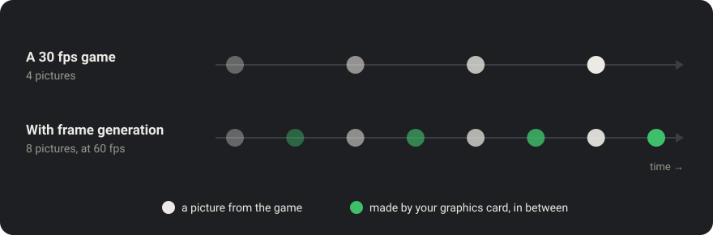

<p align="center">
  <picture>
    <source media="(prefers-color-scheme: dark)" srcset="assets/brand/logo-lockup-for-dark-bg.svg">
    
  </picture>
</p>

<p align="center">
  <a href="https://github.com/mattiasbrandt/protoHDMIcapture/actions/workflows/check.yml"></a>
  <a href="https://github.com/mattiasbrandt/protoHDMIcapture/actions/workflows/release.yml"></a>
</p>

<p align="center">
  <b>A lightweight, open-source capture card viewer. Low delay, nothing else in the way.</b><br>
  Upscaling and frame generation when you want them.
</p>

protoHDMIcapture shows the picture and plays the sound from anything with
HDMI (a console, a camera, another PC) through a USB capture card, on Linux
and Windows. It does that one job: no recording, no streaming, no account.

## Why you'll like it

- 🪶 **Small and simple.** One program and one plain-text settings file.
  No vendor app, no background service: it opens straight to the picture.
- 🎮 **Low delay.** Each frame from the card goes straight to the screen,
  and `--stats` shows how long protoHDMIcapture's own part takes on your
  PC. Picture and sound each take their own fast path, with no buffering
  in between.
  <!-- TODO(#84): dequeue→presented from the next --stats run -->
  [Where the delay is](docs/how-it-works.md#why-it-is-fast).
- 🧙 **Easy setup.** A setup wizard finds your capture card, checks the
  signal, and picks sensible settings for your card, source and monitor.
- 💸 **Made for cheap capture cards.** The no-name cards sold for the price
  of a game (with a MacroSilicon MS2130 or MS2109 inside) are recognised and
  run in their best mode.
- 🔓 **Free and open source.** Read it, change it, share it.

**Extras for a gaming GPU, when you want them:**

- ✨ **Full resolution on a big monitor.** Upscaling brings the 1080p
  picture up to your 1440p, 4K or ultrawide monitor's resolution on your
  GPU, with clean edges instead of a blurry stretch.
- 🏎️ **30 fps games shown at 60.** Frame generation makes the in-between
  pictures on your GPU, from the picture alone, so it works with any game.

## Contents

- [Install](#install)
- [First run](#first-run)
- [Keys](#keys)
- [GPU enhancements](#gpu-enhancements)
- [Works with](#works-with)
- [Troubleshooting](#troubleshooting)
- [Help test it](#help-test-it)
- [Settings](#settings)
- [More](#more)

## Install

Download the package for your system from the
[releases page](https://github.com/mattiasbrandt/protoHDMIcapture/releases).

| System | How |
|---|---|
| **Linux** (Debian 12, Ubuntu 24.04, Fedora, Arch or newer) | unpack `protohdmicapture-<version>-x86_64-linux.tar.gz` and run `./install.sh` in it |
| **Windows 10/11** | run the `.msi`; it installs for your user, with no administrator prompt |

> [!NOTE]
> Linux needs a Wayland desktop, a Vulkan graphics driver and PipeWire.
> Matching the monitor's refresh rate and placing the window need Hyprland;
> other desktops show the picture without them. Windows needs DirectX 12.

More detail, and building it yourself: [packaging/INSTALL.md](packaging/INSTALL.md).

## First run

Start **protoHDMIcapture** from your app menu, or run `protohdmicapture`.
The first time, the setup wizard opens in the window and walks you through:

1. your capture card,
2. what is plugged into it (PS5, Xbox, Switch, a PC…),
3. the picture format and a quick signal check,
4. the sound,
5. fullscreen or a window, and the monitor's refresh rate,
6. the GPU enhancements (Upscaling turned on where it helps; frame
   generation offered, off unless you pick it),
7. the audio sync, so the sound lines up with the picture.

Nothing is saved until the last screen shows what will change. Run it again
any time with **u** in the overlay, or `protohdmicapture --setup`.

> [!TIP]
> **Black picture?** Turn HDCP off on the console first: nothing else
> matters until it is. The wizard shows how for your console.

## Keys

| Key | What it does |
|---|---|
| **Tab** | open or close the overlay: every setting with its current value |
| **f** | fullscreen → borderless → windowed |
| **c** | picture size: 1080p → 1440p → 4K, the sizes your monitor fits |
| **g** | frame generation: off → ffx → rife → off |
| **ctrl −** / **ctrl +** | sound 10 ms earlier / later (**alt** for 50 ms) |
| **m**, **9** / **0** | mute; volume down / up |
| **1**–**8** | contrast, brightness, gamma, saturation down / up |
| **s** | a screenshot to `~/Pictures/protoHDMIcapture/` |
| **d** | the dashboard: frame rates, delay, sound, GPU |
| **q** | quit |

With the overlay open: **w** saves what you changed, **u** runs the setup
wizard, **t** shows the setup tips for your console, **l** switches the
colour range (auto → limited → full), **r** resets the colour, and **Esc**
closes it. A change you don't save with **w** lasts until you close the
viewer.

## GPU enhancements

Two optional extras for a dedicated gaming GPU. Both work from the captured
picture alone: a capture card never sees the game's own data.

### Upscaling: your monitor's full resolution

On a monitor with a higher resolution than the capture (1440p, 4K or
ultrawide), Upscaling raises the picture to that resolution with clean
edges, where a plain stretch looks soft, for about 0.2 ms of GPU work a
frame at 1440p.

- **Turn it on:** the setup wizard does it for you with a gaming GPU on a
  bigger monitor. Or set `UPSCALING=fsr` (AMD FSR 1, the recommended one) or
  `nis` (NVIDIA Image Scaling).
- **Pick the size** with **c**: 1080p → 1440p → 4K, as far as your monitor
  goes, always keeping the picture's shape.
- On a 1080p monitor the picture is already shown pixel for pixel, so there
  is nothing to upscale.

### Frame generation: 30 fps games at 60

Many console games run at 30 fps. Frame generation makes a picture halfway
between each two frames, so the game looks like 60 fps.

<p align="center">
  
</p>

| | |
|---|---|
| **Turn it on** | press **g**, or set `FRAMEGEN=ffx` or `rife`. It is never turned on for you |
| **ffx** | the lighter one: about 3 ms of GPU work a frame on a gaming GPU such as an RX 9070 XT |
| **rife** | a neural network: about 7 ms a frame |
| **The cost** | about one frame of extra delay (17 ms), because the in-between picture needs the next real one |
| **When it works** | on a steady 30 fps game. A 60 fps game, menus and dips show the game's own frames |
| **Needs** | a dedicated gaming GPU; it won't run on built-in (integrated) graphics |

> [!NOTE]
> Without the game's own motion data, fast camera turns, repeating patterns
> (a building's windows) and scene changes can show smears or sparkles. Try
> both methods with **g** and keep what looks best to you.

> [!TIP]
> A GPU slows down for a light 60 fps load, which makes both enhancements
> slower. protoHDMIcapture asks
> [GameMode](https://github.com/FeralInteractive/gamemode) for full speed
> while one runs; on Linux, let GameMode raise the GPU's clocks in
> `/etc/gamemode.ini` ([how](docs/testing.md#gamemode-77)).

## Works with

**Tested** means it ran end to end on a real setup; **untested** means it
should work but nobody has reported it yet. Tried something untested?
[Help test it](#help-test-it).

| | Status |
|---|---|
| **MS2130** card (USB 3, often sold as "USB3.0 Video Capture HDMI 4K") | **Tested** on the developer's PC: uncompressed 1080p60. Needs a USB 3 port, and is steadiest with its power cable connected. "4K" is the input and loop-out; capture is 1080p |
| **MS2109** card (USB 2 sticks) | **Tested** on the developer's PC: 720p60; 1080p30 measured too |
| Other cards | Untested: the wizard shows what they offer. [Every card seen so far](docs/capture-cards.md) |
| **PlayStation 5** | **Tested** on the developer's PC |
| PlayStation 4, Xbox Series X/S, Switch, Switch 2, a PC, other HDMI sources | Untested: their setup tips come from the makers' own docs |
| **Linux** with Hyprland (Wayland) | **Tested** on the developer's PC |
| Linux, other Wayland desktops | Untested: the picture should show; matching the refresh rate and placing the window need Hyprland |
| **Windows 11** | **Tested** on a laptop with the MS2130 ([#19](https://github.com/mattiasbrandt/protoHDMIcapture/issues/19)). A desktop PC is untested ([#50](https://github.com/mattiasbrandt/protoHDMIcapture/issues/50)) |
| **AMD** graphics (RX 9070 XT) | **Tested** on the developer's PC, Upscaling and frame generation included |
| **Built-in** graphics (Intel UHD 620) | **Tested** on the Windows laptop for the picture ([#19](https://github.com/mattiasbrandt/protoHDMIcapture/issues/19)); frame generation doesn't run on built-in graphics |
| NVIDIA graphics | Untested: prepared, waiting for a tester ([#87](https://github.com/mattiasbrandt/protoHDMIcapture/issues/87)) |

The source settings that give a black picture or bad sound when wrong
(HDCP, HDR, audio format) have one page per source:
[PlayStation 5](sources/ps5.md), [PlayStation 4](sources/ps4.md),
[Xbox Series X/S](sources/xbox-series.md), [Nintendo Switch](sources/switch.md),
[Nintendo Switch 2](sources/switch-2.md), [a Windows PC](sources/pc.md),
[any HDMI source](sources/generic.md).

## Troubleshooting

| Problem | Fix |
|---|---|
| **Black picture** | turn HDCP off on the console, and check it is awake |
| **Low frame rate, or no 1080p60** | the card is on a USB 2 port: use a USB 3 port, not a hub. The wizard's card details show the speed |
| **The card drops out** | connect its power cable, and avoid hubs without their own power |
| **Sound before or after the picture** | **ctrl −/+** until it lines up, then **w** to save; menu clicks make a good test. Tune again after changing the card or the monitor |
| **Upscaling or frame generation slower than expected** | let GameMode raise the GPU's clocks ([how](docs/testing.md#gamemode-77)) |
| **Every frame matters (fast shooters)** | the card itself adds most of the delay: play on a TV or monitor plugged into the card's HDMI loop-out (no delay at all), and keep protoHDMIcapture for watching on the PC |

`--debug` opens the dashboard, and `DEBUG=log` writes a log of every
decision. Less common problems, and the details behind all this:
[docs/how-it-works.md](docs/how-it-works.md).

## Help test it

protoHDMIcapture has run on only a few setups, so a report from yours helps,
even "it didn't start".
[Open an issue](https://github.com/mattiasbrandt/protoHDMIcapture/issues/new) with:

- your capture card (the setup wizard's card page shows its USB id),
- what is plugged into it (PS5, Switch, a PC…),
- your GPU, your monitor and its refresh rate,
- Linux and which desktop, or Windows,
- what happened, and what you expected.

Paste the output of these two as well:

```bash
protohdmicapture --settings             # every setting and where it came from
protohdmicapture --stats --seconds 60   # a minute of delay numbers; the summary names the GPU
```

For a problem that comes and goes, run with `DEBUG=log` and attach
`debug.log` from `$XDG_RUNTIME_DIR/protohdmicapture/` (Windows:
`%LOCALAPPDATA%\protohdmicapture\`).

## Settings

The setup wizard and **w** write the settings file for you:
`~/.config/protohdmicapture/config` on Linux,
`%APPDATA%\protohdmicapture\config` on Windows. One `KEY=value` per line;
[config.example](config.example) explains each one, and
`protohdmicapture --settings` shows every value and where it came from.

### The settings worth knowing

The ones you are most likely to change:

- `UPSCALING`: raise the picture to a bigger monitor's resolution (`off`, `fsr`, `nis`).
- `FRAMEGEN`: 30 fps games shown at 60 (`off`, `ffx`, `rife`).
- `WINDOW`: `fullscreen`, `borderless` or `windowed`.
- `REFRESH`: `match` switches the monitor to the game's refresh rate.
- `DELAY`: the audio sync, in seconds.
- `SOURCE`: your console, for its setup tips.

<details>
<summary>Every setting (click to open)</summary>

| Setting | Default | What it does |
|---|---|---|
| `SOURCE` | — | what is plugged in: a source profile name from `sources/` (`ps5`); its setup tips show in the overlay |
| `CARD_SERIAL` | — | the capture card's USB serial; pins it among other cameras and across `/dev/video` renumbering |
| `CARD_PORT` | — | the USB port (udev `ID_PATH`) of a card that reports no serial; found again after a replug into the same port. Any of `CARD_SERIAL`, `CARD_PORT`, `DEV` set in the environment overrides all three in the file |
| `DEV` | — | the card's node (`/dev/videoN`) instead of finding it; node numbers move on a replug, so prefer the serial or the port. A `DEV` that is gone, not a capture node, or an ignored device is set aside with a warning |
| `IGNORE_CARDS_RE` | — | ignored devices: card types (extended regex) never opened as the capture card, e.g. `Integrated Camera` |
| `SRC` | — | the audio input to play; default: the card audio input, found on the card's USB device |
| `SINK` | — | the output to play it on; default: the desktop's default output, followed when it changes |
| `RES` | `1920x1080` | capture size; the wizard picks it from the card's own modes |
| `FPS` | `60` | capture frame rate; also what `REFRESH=match` matches |
| `FMT` | `yuyv422` | capture format: `yuyv422` (uncompressed) or `mjpeg`. `nv12` and `rawvideo` are legacy only |
| `DELAY` | `0.05` | the audio sync in seconds, 0 to 1; **ctrl/alt −/+** tune it live, **w** saves it |
| `LAT_MS` | `10` | the sound's buffer in ms; raise it if the sound crackles |
| `AUDIO` | `loopback` | `loopback`, or `none` for no sound; `mpv` is legacy only |
| `WINDOW` | `fullscreen` | `fullscreen` (the lowest delay), `borderless` (the desktop's bar stays visible) or `windowed`; **f** cycles it |
| `WINDOW_SIZE` | `1280x720` | the window's size when windowed |
| `REFRESH` | `keep` | `match` switches the monitor to its refresh rate nearest `FPS` while the viewer runs, and back after (Hyprland) |
| `SCALING` | `balanced` | how the picture is resized when Upscaling is not doing it: `balanced`, `fast` (softer) or `high-quality`; `config` is legacy's, read as balanced here |
| `UPSCALING` | `off` | raises the picture to a bigger monitor's resolution: `fsr` (AMD FSR 1) or `nis` (NVIDIA Image Scaling, up to 2x); the setup wizard turns it on with a dedicated GPU |
| `UPSCALE_TO` | `fit` | the size the picture is shown at: `fit` (as large as the window allows), or `720p` … `4320p` while it fits; **c** steps it, **w** saves it |
| `FRAMEGEN` | `off` | frame generation for a 30 fps game, at one frame of extra delay: `ffx` (about 3 ms a frame on a gaming GPU) or `rife` (about 7 ms); not on built-in graphics; **g** cycles it, **w** saves it |
| `LEVELS` | `auto` | the colour range of the card's frames: `limited` or `full` if blacks look crushed or washed out. `auto` reads YUYV as limited and MJPEG as full |
| `BRIGHTNESS`, `CONTRAST`, `SATURATION`, `GAMMA` | `0` | colour adjustments, -100 to 100; keys **1**–**8** change them, **w** saves them |
| `DEBUG` | `off` | `log`, or `window` for the log and the dashboard; `--debug` is `window` for one run |
| `BACKEND` | `mpv` | legacy's player: `mpv`, or `gst` and `ffplay` for comparisons; protoHDMIcapture refuses the last two |
| `IPC` | `/tmp/mpv-protohdmicapture.sock` | legacy only: mpv's IPC socket |
| `GST_IO_MODE` | `mmap` | legacy's gst only: `mmap` or `dmabuf` |
| `FULLSCREEN` | — | deprecated: `yes` is `WINDOW=fullscreen`, `no` is `WINDOW=windowed` |

</details>

## More

- **How it works, in detail:** [docs/how-it-works.md](docs/how-it-works.md):
  why the delay is low, each wizard step, the dashboard and the log, display
  details, and less common problems.
- **protoHDMIcapture legacy:** the original bash + mpv version, Linux only,
  kept best effort; it reads the same settings file: [legacy/README.md](legacy/README.md).
- **Contributing:** [CONTRIBUTING.md](CONTRIBUTING.md); testing on real
  hardware: [docs/testing.md](docs/testing.md).

## License

MIT or Apache-2.0, at your option ([MIT](LICENSE-MIT),
[Apache-2.0](LICENSE-APACHE)). The code and data ported from other projects
(FSR 1, NIS, and the frame generators' FidelityFX, afmf-linux, openfg and
RIFE parts) keep their MIT notices:
[THIRD-PARTY-NOTICES.md](THIRD-PARTY-NOTICES.md).
